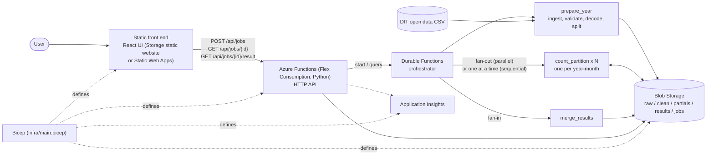

# Road Safety Explorer

A serverless web app on Azure. A user picks a year, runs an analysis of Great Britain's road collision data, and explores the result by month, severity and local authority. The same analysis can be run **sequentially** or **in parallel** (fan-out/fan-in), and the app reports what that changed in runtime and estimated compute cost.

**Data:** Department for Transport STATS19 collision records (Open Government Licence). The data covers police-reported personal-injury collisions on public roads in Great Britain. It does not include damage-only collisions or collisions not reported to the police, and raw counts are not a measure of road risk. The charts are labelled accordingly.

## Architecture



| Brief requirement | Where it is in this repo |
|---|---|
| Serverless architecture | React front end served as static files (`web/`), Python Azure Functions on Flex Consumption (`api/`), Blob Storage for inputs and results |
| Inter-service communication | `POST /api/jobs` returns a job ID; the UI polls `GET /api/jobs/{id}`; the API starts a Durable Functions orchestration; activities read and write blobs; `GET /api/jobs/{id}/result` returns the summary |
| Data modelling | Collision record, summary row and job record (see [Data model](#data-model)); every job stores the dataset version it used |
| Data pipeline | Ingest CSV, validate and decode, split into monthly files, count each partition, merge (`api/pipeline.py`) |
| Parallel processing and scaling | `analysis_orchestrator` in `api/function_app.py`: `task_all` over one activity per partition versus the same activities awaited one at a time |
| Infrastructure as Code and cost | `infra/main.bicep`, `scripts/deploy.sh`, `scripts/benchmark.py` |

## Repository layout

```
analysis/reference_analysis.py   independent pandas reference for checking cloud results
api/function_app.py              HTTP endpoints, orchestrator, activities
api/pipeline.py                  pure pipeline logic (no Azure imports)
api/lookups/                     local authority code -> name, from the DfT data guide
web/                             React front end (Vite)
infra/main.bicep                 all Azure resources
scripts/deploy.sh                one-command deploy and teardown
scripts/benchmark.py             sequential versus parallel benchmark
tests/test_pipeline.py           unit tests for the pipeline logic
```

## API

| Method and path | Purpose |
|---|---|
| `POST /api/jobs` with `{"years": [2023], "mode": "parallel"}` | Start an analysis. Returns `202` and `{"job_id": "..."}`. `mode` is `parallel` or `sequential`. |
| `GET /api/jobs/{id}` | Job record with `status`: `Queued`, `Running`, `Complete` or `Failed`, plus progress while running and metrics when complete |
| `GET /api/jobs/{id}/result` | `{job, summary}` once the job is complete |
| `GET /api/jobs` | Recent completed job records (used by the comparison panel) |
| `GET /api/meta` | Selectable years and the data scope note |

## Data model

**Collision record** (one row per `collision_index`; blobs `clean/{year}/{dataset_version}/month-MM.csv`)

| Field | Notes |
|---|---|
| `collision_index` | Unique ID; duplicates are rejected |
| `date`, `year`, `month` | Parsed from `DD/MM/YYYY`; must fall in the requested year |
| `severity_code`, `severity` | 1 Fatal, 2 Serious, 3 Slight (severity of the most seriously injured casualty) |
| `la_code`, `la_name` | ONS local authority district code, decoded with the DfT data guide |

**Summary row** (one row per year x month x local authority x severity; in `results/{job_id}/summary.json`)

`[year, month, la_code, severity_code, collisions]`

**Job record** (one per analysis run; blob `jobs/{job_id}.json`)

`job_id`, `years`, `mode`, `status`, `created_at`, `completed_at`, `datasets[]` (year, `dataset_version`, `raw_sha256`, `source_url`, `ingested_at`, input, accepted and rejected counts), `metrics` (runtime, executions, workers, estimated GB-seconds) and `result` (path, checksum, reconciliation flag).

`dataset_version` is the first 12 characters of the SHA-256 of the raw CSV, so a result can always be traced back to the exact input file.

### Validation rules

Each input record is either accepted into exactly one monthly partition or counted under one rejection reason: missing collision index, duplicate collision index, invalid date, date outside the requested year, invalid severity, or missing local authority. The pipeline checks that input = accepted + rejected, and that the summary counts add up to the accepted records. Both figures are shown in the app under "Where these numbers came from".

## Run it locally

Prerequisites: Python 3.10+, Node 18+, [Azure Functions Core Tools v4](https://learn.microsoft.com/azure/azure-functions/functions-run-local), [Azurite](https://learn.microsoft.com/azure/storage/common/storage-use-azurite).

```bash
# 1. Reference analysis (milestone 1)
pip install pandas pytest
python analysis/reference_analysis.py 2023
python -m pytest tests -q

# 2. API
azurite --silent --location /tmp/azurite &
cd api
pip install -r requirements.txt
cp local.settings.json.example local.settings.json
func start

# 3. Front end (new terminal)
cd web
npm install
npm run dev          # http://localhost:5173, proxies /api to the Functions host
```

## Deploy to Azure

In Azure Cloud Shell (Bash), or any shell with `az`, `node` and `zip`, signed in to the right subscription:

```bash
git clone <this repo> && cd <repo>
./scripts/deploy.sh                             # resource group rg-road-safety-explorer in uksouth
RG=my-rg LOCATION=norwayeast ./scripts/deploy.sh   # or choose your own
FRONTEND=staticWebApp ./scripts/deploy.sh       # host the UI on Static Web Apps instead
```

The script registers the resource providers, creates the resource group, deploys `infra/main.bicep`, publishes the function code, builds the front end against the function app URL, uploads it and smoke-tests the API. It prints the web app URL at the end.

**Region and front-end hosting.** Some subscriptions restrict regions by policy. Azure for Students allowed only `polandcentral`, `austriaeast`, `denmarkeast`, `italynorth` and `norwayeast` when this was deployed (check yours with `az policy assignment list`). Static Web Apps (Free) is offered in five other regions only, so the default front-end host is a **Storage static website** in the same region as everything else: static files served from Blob Storage, with no server to manage. Set `FRONTEND=staticWebApp` where a Static Web Apps region is allowed; the React app and the API contract are identical either way.

To delete everything: `./scripts/deploy.sh --destroy`.

## Benchmark sequential versus parallel

```bash
python3 scripts/benchmark.py --api https://<function-app>.azurewebsites.net --years 2023 --runs 5
python3 scripts/benchmark.py --api https://<function-app>.azurewebsites.net --years 2021 2022 2023 2024 2025 --runs 5
```

The script does an uncounted warm-up run (which also ingests the data), then alternates modes so warm and cold effects fall on both. It reports median runtime, executions, worker instances and estimated compute cost, and checks that every run produced the same output. Results are written to `benchmark-results.md` and `benchmark-results.json`.

How to read the numbers:

- **Counting-stage runtime** is measured inside the orchestrator around the stage that differs between modes. **End-to-end runtime** is from job submission to the completed job record.
- **Distinct worker instances** separates concurrency inside one instance from real scale-out across instances. `maxConcurrentActivityFunctions` in `api/host.json` (currently 4) controls how many activities one instance runs at once; lowering it pushes the platform to add instances sooner.
- **One year is a small workload** (about 8,700 records per monthly partition, tens of milliseconds of work each). If parallel is no faster, or slower, that is a finding: orchestration overhead outweighs the benefit at this size. The five-year run (60 partitions) is the larger test.
- **Estimated compute cost** is instance-busy time multiplied by configured instance memory, at the on-demand Flex Consumption rates in the script, before the monthly free grant. It is Functions compute only. Blob Storage capacity and transactions, Durable Functions task hub storage transactions and Application Insights ingestion are billed separately and are not in that figure. Check the rates against the [Azure Functions pricing page](https://azure.microsoft.com/pricing/details/functions/) for your region before quoting them.

Exact execution counts for a period, from Application Insights (Logs):

```kusto
requests
| where timestamp > ago(1h)
| summarize executions = count(), avg_ms = avg(duration) by name, cloud_RoleInstance
| order by executions desc
```

### Check the cloud result against the local reference

```bash
curl -s https://<function-app>.azurewebsites.net/api/jobs/<job_id>/result -o cloud-summary.json
python analysis/reference_analysis.py 2023 --compare cloud-summary.json
```

## Design decisions

- **Batch processing with precomputed summaries, not querying the raw CSV per interaction.** The raw file is about 20 MB and 100,000 rows per year, and it changes once a year. Scanning it on every filter change would mean seconds of compute per click and a cost that grows with usage. Instead each job produces a small summary (year x month x local authority x severity) that the browser filters instantly. The trade-off is that the dashboard can only answer questions the summary was built for.
- **Durable Functions for the workflow.** The orchestrator gives job status, retries and fan-out/fan-in without a separate queue and state store, and lets both execution modes share exactly the same activity code.
- **Activities exchange blob paths, not data.** Partial counts are written to Blob Storage and only small references pass through the orchestration history, which keeps replays cheap.
- **Preparation is cached and kept out of the benchmark window.** Ingestion and splitting happen once per year and dataset version, so the comparison measures only the stage whose dispatch strategy differs.
- **Connection-string access to storage.** Simpler to deploy for coursework. A production version would use a managed identity with role assignments and disable shared-key access.

## Limitations

- The API is anonymous so the demo can be opened by a marker. Requests are limited to the configured years and two modes, but there is no rate limiting.
- Single-year collision files are only published for the most recent five years, so those are the selectable years.
- Collision counts use the collision table only. Adding the vehicle or casualty tables would need care so that one-to-many joins do not inflate collision counts.
- Results are counts, not rates. Comparing local authorities by raw count mostly reflects size and traffic.
